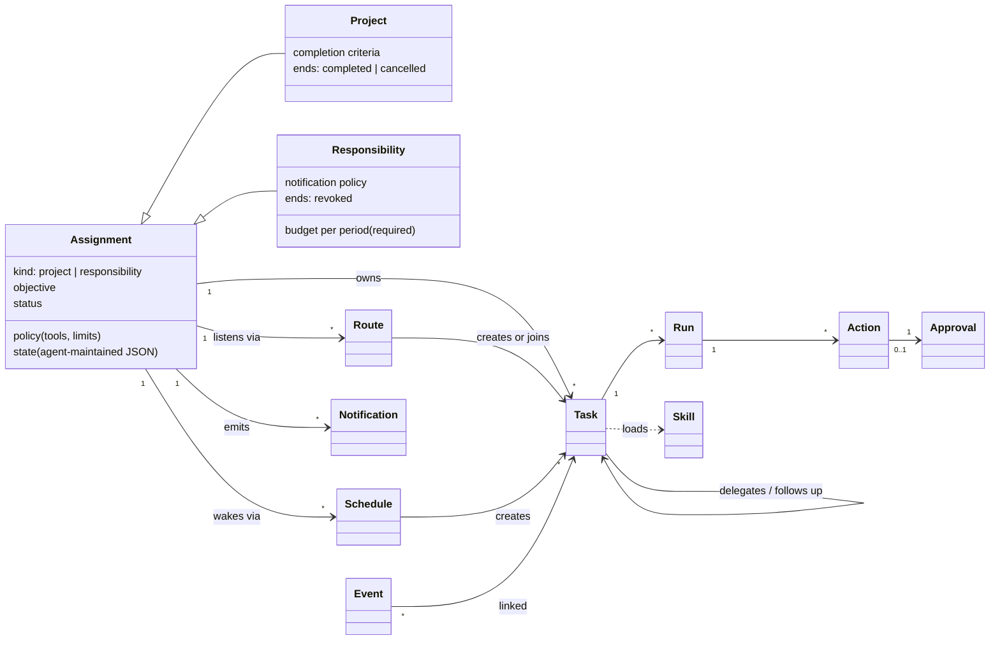
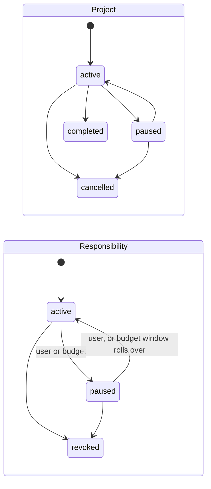
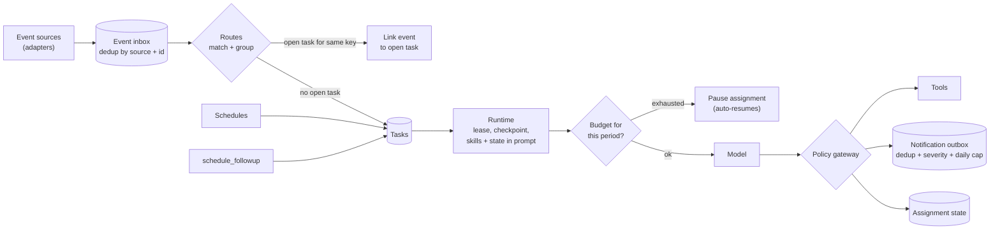

# Baseet architecture

Baseet is a personal agent that runs continuously on one Mac mini. `agentd` is its runtime: one Go
process, one SQLite database, any model provider. This document is the domain model and the rules
the code enforces. The README covers how to run it.

## Principles

1. **Autonomy is the default; the boundaries are code.** The model decides *how* to do the work.
   Deterministic code decides *what it may do*: every side effect goes through the policy gateway.
2. **Everything that matters is durable.** Assignments, tasks, conversation checkpoints, actions,
   events and notifications live in SQLite. A restart or `kill -9` loses no work and repeats no
   side effect.
3. **The engine is domain-agnostic.** Portfolio monitoring, refund disputes and apartment searches
   are configurations of the same parts. No domain logic lives in the runtime.
4. **Spend the model only where judgement is needed.** Deduplication, routing, grouping, scheduling
   and limits are deterministic code that runs before any model call.

## Domain model



| Concept | What it is | Owns | Does not own |
|---|---|---|---|
| **Assignment** | Something Baseet is responsible for. Either a Project or a Responsibility. | Objective, policy (tool rules + limits), status, durable state, budget. | How the work is done. |
| **Project** | A finite, goal-driven assignment with explicit completion criteria. | Completion criteria. Ends `completed` or `cancelled`. | Notifications policy, periodic budget. |
| **Responsibility** | A persistent, potentially indefinite assignment Baseet manages until paused or revoked. | Notification policy, a budget that resets every period. Ends only when `revoked`. | A completion state. It is never "done". |
| **Route** | A deterministic rule: events of this source/kind whose payload matches → a task. Optionally groups events by a payload field. | Matching, grouping, which skills the task loads. | Any judgement; it never calls a model. |
| **Schedule** | A recurring wake-up for an assignment. | Interval, next fire time, skills. | Catch-up: missed slots during downtime fire once. |
| **Event** | Something that happened outside, stored once per `(source, external_id)`. | Payload (untrusted data). | Instructions. |
| **Task** | One durable unit of work for an assignment. Created by a person, route, schedule, follow-up or delegation. | Objective, lifecycle, tool allowlist, skills, limits. | Scheduling itself or permission to act. |
| **Run** | One checkpointed conversation that executes a task. Resumed, not restarted, after a crash. | Messages, step count. | Side effects. |
| **Action** | One proposed tool call, persisted before it runs, keyed `run:step:call`. | Status, result, provider id. | Its own authorization. |
| **Skill** | Reusable know-how a task can load: instructions (and the tools it expects). | Nothing at runtime. | Scheduling, autonomy, permissions. A skill never grants a tool. |
| **Notification** | A message for the user in a durable outbox, deduplicated per assignment. | Severity, dedup key, delivery status and attempts. | Delivery channel (an adapter such as ntfy). |
| **Approval** | A human decision bound to one action's exact arguments, with an expiry. | Decision. | Anything beyond that one action. |

### Lifecycles



The database enforces this per kind (a responsibility cannot be `completed`; a project cannot be
`revoked`), and `paused_by` records whether a person or the budget paused it. Budget pauses lift
themselves when spend falls back under the cap for the current window; a person's pause never does.

Task lifecycle (unchanged): `ready → running → {completed | waiting_approval | waiting_event |
retryable | blocked}`, with leases so a crashed worker's task is picked up again.

## How a responsibility runs



1. An event arrives and is stored once.
2. A route matches it deterministically. If the route groups by a field (e.g. `symbol`) and an open
   task already exists for that value, the event is linked to that task instead of creating new
   work.
3. Schedules and agent-planned follow-ups create tasks at their due time, exactly once.
4. The runtime leases a task, loads the assignment's state and the task's skills into the system
   prompt, and checks the budget for the current period before every model call.
5. Every tool call, including `notify` and `update_state`, goes through the gateway: assignment
   active, task allowlist, policy rule, rate limit, approval if required, then dispatch.
6. The agent keeps the responsibility's state current (`update_state`) and books its own next
   wake-up (`schedule_followup`) when something needs checking later.

## The eight requirements

| # | Requirement | Where it lives |
|---|---|---|
| 1 | Objectives, triggers, schedules, permissions, notification policies, budgets | `assignments` (objective, policy, notification policy, budget period), `event_routes`, `schedules`. A responsibility cannot be created without a periodic budget and a notification policy. |
| 2 | Durable tasks in response to events | Event inbox → routes → tasks, in one transaction, keyed so each event creates at most one task per route. |
| 3 | Tasks invoke skills; skills own no scheduling or autonomy | `skills` package: instructions loaded into a task's prompt. A skill has no trigger, schedule, budget or permission fields, and never widens the task's tool allowlist. |
| 4 | Persist across restarts | Everything is in SQLite; covered by restart tests at every layer. |
| 5 | Plan follow-up work and future wake-ups | `schedule_followup` (one-off) and schedules (recurring); both idempotent across crashes. |
| 6 | No duplicate alerts, repeated work or unnecessary LLM calls | See the next section. |
| 7 | Current state, recent activity, next expected action | `overview` package and `agentd show <id>`: state, spend vs budget, open tasks, last 10 audit entries, and the next expected action derived from approvals, running/ready tasks and schedules. |
| 8 | All actions subject to the policy gateway | Unchanged. `notify` and `update_state` are ordinary tools, so policy, allowlists, rate limits and approvals apply to them too. |

## Avoiding duplicates and wasted model calls

Each layer removes work before the next, more expensive one:

| Layer | Mechanism | Prevents |
|---|---|---|
| Inbox | Unique `(source, external_id)` | The same event processed twice. |
| Routes | Deterministic payload match | Model calls on irrelevant events. |
| Grouping | `coalesce_field` + one open task per key | Ten updates about one thing becoming ten investigations. Events grouped before a run starts are in its opening messages; events grouped mid-run must be read (`task_events`) before the task may finish. |
| Tasks | `origin_key` on every system-created task | Duplicate tasks from retries, restarts or repeated schedule fires. |
| Runtime | Checkpointed runs; restarts resume, never replay | Re-asking the model for steps already taken. |
| Gateway | Action ledger + reconcile before retry | Repeating a side effect whose outcome is unknown. |
| Outbox | Dedup key within a window, severity floor, daily cap | Alerting the user twice about the same issue, or too often. |
| Budget | Worst-case cost reserved atomically before each call, settled with the real cost after | Runaway spend, including several workers each passing the check at once; the responsibility pauses and resumes itself next period. |

## Invariants

1. Every tool call is persisted as an action, keyed `run:step:call`, before it runs.
2. Policy is evaluated by code on every dispatch; no rule means deny.
3. An approval binds to the action's exact argument hash and expires.
4. A crash mid-dispatch is reconciled with the provider before anything is retried. A tool answers
   happened, did not happen, or unknown; only a tool with authoritative evidence may say "did not
   happen". Unknown blocks the task, and housekeeping rechecks it every minute until the provider
   confirms it or a person resolves it.
5. A task completes only when its success criteria have recorded evidence.
6. Each event, schedule slot, follow-up and delegation creates at most one task, even across crashes.
7. A task's tool allowlist is enforced by the gateway; a worker never gets a tool its parent lacks, and a skill never grants one.
8. Every model call's cost is recorded with the step it produced; reaching the cap pauses the assignment and resuming continues the same run.
9. A rate-limited tool reserves its slot in the same transaction that marks the action dispatching.
10. A responsibility always has a periodic budget and a notification policy, and can never complete; only a person can revoke it.
11. Only adapters import provider SDKs, and only `cmd/` picks an adapter (`internal/archtest`).
12. Emergency stop is a durable flag checked at every point of execution: no task is claimed, no model call starts, and no tool dispatches while it is set. Intake (events, schedules) keeps recording work for later. A model call already in flight finishes, but its tool calls do not run.
13. No event linked to a task is silently dropped: it is either in the run's opening messages or the task cannot finish until it has read it (when its policy allows `task_events`).
14. A task's lease is renewed by a heartbeat for as long as it executes, and every dispatch and model-step write is fenced on that lease in the same transaction; a reclaimed task always resumes its latest run. A lease counts only while unexpired: an expired lease cannot be renewed, fence a write or start a dispatch, even if nobody has reclaimed it yet. Any renewal error stops the work, so a heartbeat failure is never mistaken for a renewal. Release still accepts an expired but unclaimed lease, because it only records an outcome that already happened.
15. Agent-written state is shown to the model as labelled data, never as part of the system prompt.
16. The HTTP API refuses every request without the bearer token, including when no token is configured, and agentd refuses to bind it to every interface.
17. A project completes on its own only when every completion criterion has recorded evidence and none of its actions has an unknown outcome. Evidence is either an ingested event that matches the criterion (source, kind and payload fields, received after the project was created) or an owner's `agentd confirm`. The model has no tool that records evidence, so a task finishing or an email being sent never completes a project. Evidence is append-only and recorded once per criterion.
18. An obligation is judged only by recorded evidence (a delivered notification, a successful action, or a received event), never by a schedule having fired. An overdue obligation gets at most one remediation task per missed interval, none while an earlier one is still open or blocked, and an escalation to the owner after three missed intervals; an obligation about an outside feed notifies instead of spawning work. Nothing happens for a paused, revoked or halted assignment.
19. A run talks to one model. It is pinned when the run opens, to the first configured model the assignment's `models` policy allows, and changes only before the model's first reply (fallback after an error) or when the pinned model is gone and the conversation holds no provider-private data. Every switch is audited, and a local-only assignment is never sent to a cloud model.
20. A tool that is not registered when its persisted call comes up never crashes the process. A prepared or approved call waits for it with backoff, making no model call and counting no failure, and is authorized against the live tool once it returns; after 24 hours the task blocks and the owner is notified once. An interrupted dispatch whose tool is gone has an unknown outcome (invariant 4). A panic in one task fails only that attempt, and a panic in housekeeping is logged; the other workers keep running.
21. An MCP tool runs only under a definition the owner accepted. Installing or connecting a server grants nothing, and a definition that changed since acceptance cannot dispatch until accepted again.

## Example: Portfolio Intelligence is configuration

[`docs/examples/portfolio-intelligence.json`](docs/examples/portfolio-intelligence.json) defines the
whole responsibility: objective, tool rules, a $20 per 30-day budget, notification policy, two routes
(price moves and news, grouped by `symbol`) and a daily brief. Its skills are plain Markdown in
[`docs/examples/skills/`](docs/examples/skills/).

```bash
agentd -skills docs/examples/skills create docs/examples/portfolio-intelligence.json
agentd show <rsp_id>
```

To make it live, only edge pieces are needed, none of them in the runtime:

- an **event source** that emits `market/price.moved` and `news/article.published` events;
- live holdings from a broker (a snapshot file works today: `-holdings`);
- (phone delivery already exists: `agentd ntfy setup`).

## Integrations

Integrations live in `internal/integrations/<name>` and plug in at the edges only: they contribute
tools (which go through the gateway like any other) and event sources (which feed the inbox). The
runtime never imports them; `cmd/` wires them in.

**Gmail** (`internal/integrations/gmail`): a small REST client, OAuth with PKCE and a loopback
redirect, credentials in the keychain. Every outgoing message carries a `Message-ID` derived from
the action's idempotency key; after a crash or an ambiguous error the tool searches Sent/Drafts for
that id before anything is retried. A search miss is never treated as "not sent": Gmail's index
can lag, so a miss leaves the action unresolved and the task blocked until a later recheck finds the
message or a person resolves it with `agentd resolve`. Reads are scoped by the policy rather than by the query: the `resources` of a
`gmail_search` or `gmail_read` rule list correspondents (`a@b.com` or `@b.com`), and the tool drops
every message whose From, To and Cc all fall outside them before anything reaches the model, so a
guessed message id or a broad search returns nothing out of scope. `gmail_send` takes exactly one recipient so
policy can allow-list contacts; anything wider must be a draft. The inbox watcher follows Gmail's
history from the moment it is connected (no backfill) and recovers from an expired history id by
re-scanning the last two days, deduplicated by message id.

**MCP servers** (`internal/integrations/mcp`): the official Go SDK, over stdio for local servers
and Streamable HTTP for hosted ones; the only package allowed to import it. Remote servers use
HTTPS only (plain HTTP for loopback), never follow a redirect to another host, and never retry a
`tools/call` inside the transport. A request whose body was never read (connection refused) or that
the server answered 401/403 is "not executed"; a timeout, reset or 5xx after sending is ambiguous.
OAuth sign-in (`agentd mcp auth`, PKCE, protected-resource and authorization-server discovery,
dynamic registration or a preregistered client) runs in the foreground; the token is bound to the
server URL, kept in the keychain or the secrets directory, and refreshed one at a time. A server
that rejects agentd's credentials enters a needs-sign-in state: its tools are not offered, calls
wait, and one notification goes out; a new sign-in is picked up without a restart. Secrets in the
config are references, never literals, and never reach the database, logs, prompts or argv. Each
server has one state (connecting, ready, needs_review, needs_auth, failed, disabled), mirrored to
`mcp_servers` so the CLI and API can show it; state changes are audited. A supervisor reconnects
dropped servers with backoff (1 s doubling to 5 min) and gives up after five failures in an hour
until `agentd mcp restart`, which reaches the running process through the database. The tool
registry never changes after startup: every tool known from the pinned table is registered even if
its server is down, and a tool whose server is not connected reports itself unavailable, so its
calls wait. Calls per server are capped, and a local server whose call exceeds its time limit is
restarted. A write's recovery is opt-in and owner-declared: `idempotent` lets an unclear outcome
count as "did not happen" (audited as `action.assumed_idempotent`), and `reconcile` injects a marker
derived from the idempotency key at dispatch, without changing the persisted arguments or their
approval hash, then looks it up through a declared, accepted read tool. A hit is "happened", a miss
stays unknown unless the owner declared the lookup authoritative after an age, and a lookup error is
unknown. Recheck settles both ways and makes no lookups while halted. Polls (`poll` in the config)
turn new items from an accepted read tool into inbox events through `Scheduler.Ingest`, without a
model call: the first poll records what exists, later polls emit unseen ids (namespaced by server
and poll, so `(source, external_id)` deduplicates overlaps and restarts), at most `max_events` per
poll, with only mapped fields in the payload. They pause while halted, while the server is down or
needs sign-in, or while the tool is not accepted, back off on errors, and after three failures in a
row notify the assignments routing that source that the feed is failing. Each remote tool becomes one `tools.Tool` named `<server>__<tool>`, so the
runtime and gateway see nothing new. The client offers servers no sampling, elicitation or roots, so
a server cannot spend the model budget, prompt the owner, or ask for files. A child process gets
only `PATH`, `HOME` and its configured env. Server annotations (`readOnlyHint` and the rest) are
self-reported and never trusted: a tool is a write unless the owner declares it a read in the
config, and a declared read the server itself marks destructive is refused. A write that provably
never left (not connected, method not found, invalid params) is "not executed"; anything else that
fails, including a result the server flags as an error, has an unknown outcome and blocks the task,
because the protocol has no idempotency keys. A read that fails is just failed, and an interrupted
read runs again. The owner may also name the argument (`channel_id`, `message.channel`) whose value
is the policy resource; a call missing it, or naming several values, is an argument error before
anything is sent. Policy rules name exact tools; there are no wildcards, because a server update
could add a tool a pattern would silently allow. Each tool's definition (name, description, schema,
annotations, as the server sent them) is hashed and recorded in `mcp_tools`; only a definition the
owner accepted (`agentd mcp accept`, or the API with the exact hash they saw) is offered or run. A
changed or removed tool is unavailable (its calls wait, per invariant 20) until reviewed, and an
action records the definition hash it was proposed under, so it never dispatches under another.
Descriptions are cleaned of control, tag and bidi-override characters and capped before they reach
a prompt; the hash covers the original text. Server `instructions` are kept for the owner's review
and never sent to a model.

**Notification delivery** (`notify.Deliverer`, `internal/integrations/ntfy`): housekeeping claims
each pending notification by pushing its next attempt two minutes out, sends it through the
configured channel, and records the result. Transient failures retry with doubling backoff (30 s up
to 1 h); a permanent failure, or the eighth attempt, parks it as failed with the error, which
`agentd notifications` and the API show. Delivery is at least once: a crash between the push and
the record re-sends it after the claim lapses. Nothing is delivered while halted, and pending
notifications of a revoked or cancelled assignment are suppressed. Suppression, dedup and the daily
cap are decided when the notification is created and never revisited. By default the push says only
which assignment needs attention; `-full` includes the title and text. The ntfy topic is a secret
kept in the keychain.

## Control surface

The HTTP API (`internal/api`) exposes assignments, tasks with transcripts, the approvals inbox, the
notification outbox, event intake, the audit log as a live SSE stream, usage, and the emergency stop.
The command center (`internal/api/ui`, served at `/`) is a client of this same API through a browser session (HttpOnly cookie plus a CSRF header); it is the only way a phone or dashboard reaches Baseet; it holds no state of its own and goes through
the same stores and gateway as the runtime. Provider-native model payloads never leave the process.

## Known limits

- **Keychain scope.** Secrets (Gmail refresh token, optional Anthropic key) are stored with
  `/usr/bin/security`, which makes that tool their trusted reader. Any process running as the same
  macOS user can read them without a prompt. The keychain protects against other users, not against
  malware running as you. `deploy/provision-user.sh` moves agentd to a dedicated non-admin account
  with owner-only secret files instead ([docs/isolation.md](docs/isolation.md)); it is opt-in.
- **MCP read scope is by argument, not content.** A `resources` list on an MCP tool matches the
  argument the owner named (which channel was asked for), not what comes back. agentd cannot filter
  results it does not understand, so a search-style MCP read with no resource argument is access to
  the whole account and should be `deny` or `approval` unless that is intended. `models.local_only`
  governs which model sees an assignment's data; it does not stop an MCP tool sending data to the
  service behind it.
- **Unconfirmed Gmail sends wait.** A send Gmail never shows in Sent (a lost message, or a lag
  that never ends) stays blocked until a person resolves it. Safer than a duplicate, but it needs
  attention: `agentd status` lists it.
- **Budget overshoot is one call.** Before each model call the runtime reserves the provider's
  worst-case cost (prompt bytes / 2 as input tokens, plus the full max-tokens output). While another
  call's reservation is open, a call that would not fit waits. When nothing is in flight, one call
  may start as long as spend is under the cap, so the cap can be exceeded by at most that one call.
  A call that errors keeps its reservation (status `unknown`) until the budget window rolls past
  it, because the provider may have billed it. A server-side fallback to a pricier model is not in
  the estimate. Ollama reports no cost and reserves nothing.
- **In-flight model calls.** An emergency stop does not cancel a model request already in progress;
  its tool calls will not run.

## Deliberately not built yet

- Event-source adapters for market data and news (Gmail exists).
- Freshness rules for completion evidence: once a criterion is verified it stays verified.

## Package map

| Package | Role |
|---|---|
| `internal/assignments` | Project and Responsibility: creation, lifecycle, policy, state; the `update_state` tool. |
| `internal/tasks` | Durable task queue: atomic claim, leases, transitions, wake-ups. |
| `internal/runtime` | Agent loop, checkpoints, budget checks and auto-resume, skill loading. |
| `internal/gateway` | The only path to side effects: action ledger, policy, approvals, rate limits, reconciliation. |
| `internal/policy` | Tool rules and limits (spend cap, budget period, rate limits). |
| `internal/scheduler` | Event inbox, routes with grouping, schedules, `schedule_followup`. |
| `internal/delegation` | `delegate` and `await_workers`: helper agents as child tasks. |
| `internal/notify` | Notification outbox and the `notify` tool. |
| `internal/outcomes` | Completion criteria evidence and automatic project completion. |
| `internal/watchdog` | Obligations: health from evidence, catch-up tasks and escalation. |
| `internal/integrations/mcp` | MCP servers' tools as agentd tools (stdio), config file. |
| `internal/integrations/ntfy` | Phone delivery channel for notifications. |
| `internal/integrations/portfolio` | `portfolio_positions`: read-only holdings from an owner-kept snapshot, exact decimal values and weights. |
| `internal/integrations/web` | `web_read`: one public page as text, with an address guard against local and private networks. |
| `internal/skills` | Skill registry, loaded from `.md` files. |
| `internal/integrations/gmail` | Gmail tools (search, read, draft, send), inbox watcher, OAuth. |
| `internal/api` | Authenticated HTTP API and SSE activity stream. |
| `internal/system` | Emergency stop flag. |
| `internal/overview` | State, spend, recent activity and next expected action for one assignment. |
| `internal/model/*` | Provider-neutral model interface and adapters (Anthropic, Ollama, scripted). |
| `internal/store`, `migrations/` | SQLite open, migrations (including safe table rebuilds). |
