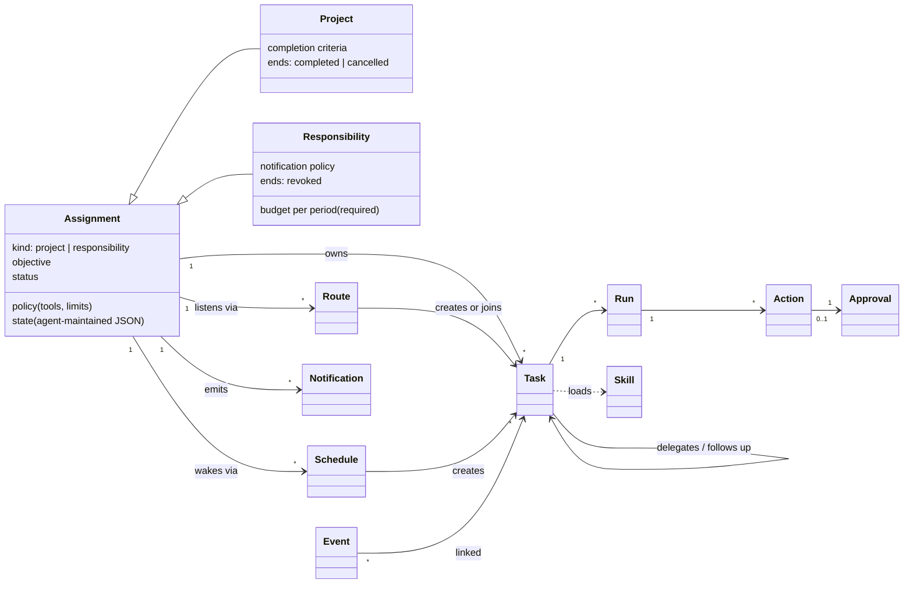
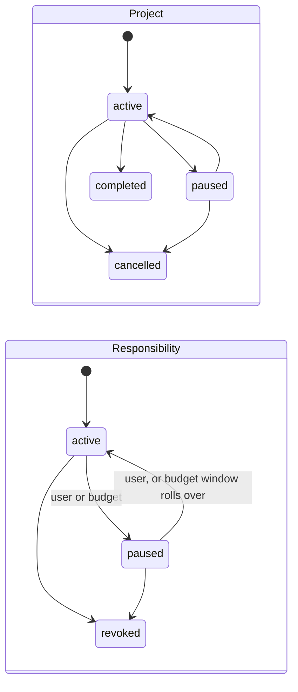
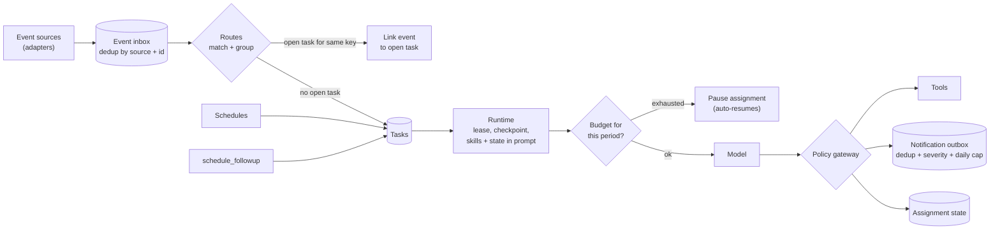

# Baseet architecture

Baseet is a personal agent that runs continuously on one Mac mini. `agentd` is its runtime: one Go
process, one SQLite database, any model provider. This document is the domain model and the rules
the code enforces. The README covers how to run it.

## Principles

1. **Autonomy is the default; the boundaries are code.** The model decides *how* to do the work.
   Deterministic code decides *what it may do*: every side effect goes through the policy gateway.
2. **Everything that matters is durable.** Assignments, tasks, conversation checkpoints, actions,
   events and notifications live in SQLite. A restart or `kill -9` loses no work and repeats no
   side effect.
3. **The engine is domain-agnostic.** Portfolio monitoring, refund disputes and apartment searches
   are configurations of the same parts. No domain logic lives in the runtime.
4. **Spend the model only where judgement is needed.** Deduplication, routing, grouping, scheduling
   and limits are deterministic code that runs before any model call.

## Domain model



| Concept | What it is | Owns | Does not own |
|---|---|---|---|
| **Assignment** | Something Baseet is responsible for. Either a Project or a Responsibility. | Objective, policy (tool rules + limits), status, durable state, budget. | How the work is done. |
| **Project** | A finite, goal-driven assignment with explicit completion criteria. | Completion criteria. Ends `completed` or `cancelled`. | Notifications policy, periodic budget. |
| **Responsibility** | A persistent, potentially indefinite assignment Baseet manages until paused or revoked. | Notification policy, a budget that resets every period. Ends only when `revoked`. | A completion state. It is never "done". |
| **Route** | A deterministic rule: events of this source/kind whose payload matches → a task. Optionally groups events by a payload field. | Matching, grouping, which skills the task loads. | Any judgement; it never calls a model. |
| **Schedule** | A recurring wake-up for an assignment. | Interval, next fire time, skills. | Catch-up: missed slots during downtime fire once. |
| **Event** | Something that happened outside, stored once per `(source, external_id)`. | Payload (untrusted data). | Instructions. |
| **Task** | One durable unit of work for an assignment. Created by a person, route, schedule, follow-up or delegation. | Objective, lifecycle, tool allowlist, skills, limits. | Scheduling itself or permission to act. |
| **Run** | One checkpointed conversation that executes a task. Resumed, not restarted, after a crash. | Messages, step count. | Side effects. |
| **Action** | One proposed tool call, persisted before it runs, keyed `run:step:call`. | Status, result, provider id. | Its own authorization. |
| **Skill** | Reusable know-how a task can load: instructions (and the tools it expects). | Nothing at runtime. | Scheduling, autonomy, permissions. A skill never grants a tool. |
| **Notification** | A message for the user in a durable outbox, deduplicated per assignment. | Severity, dedup key, delivery status. | Delivery channel (adapters come later). |
| **Approval** | A human decision bound to one action's exact arguments, with an expiry. | Decision. | Anything beyond that one action. |

### Lifecycles



The database enforces this per kind (a responsibility cannot be `completed`; a project cannot be
`revoked`), and `paused_by` records whether a person or the budget paused it. Budget pauses lift
themselves when spend falls back under the cap for the current window; a person's pause never does.

Task lifecycle (unchanged): `ready → running → {completed | waiting_approval | waiting_event |
retryable | blocked}`, with leases so a crashed worker's task is picked up again.

## How a responsibility runs



1. An event arrives and is stored once.
2. A route matches it deterministically. If the route groups by a field (e.g. `symbol`) and an open
   task already exists for that value, the event is linked to that task instead of creating new
   work.
3. Schedules and agent-planned follow-ups create tasks at their due time, exactly once.
4. The runtime leases a task, loads the assignment's state and the task's skills into the system
   prompt, and checks the budget for the current period before every model call.
5. Every tool call, including `notify` and `update_state`, goes through the gateway: assignment
   active, task allowlist, policy rule, rate limit, approval if required, then dispatch.
6. The agent keeps the responsibility's state current (`update_state`) and books its own next
   wake-up (`schedule_followup`) when something needs checking later.

## The eight requirements

| # | Requirement | Where it lives |
|---|---|---|
| 1 | Objectives, triggers, schedules, permissions, notification policies, budgets | `assignments` (objective, policy, notification policy, budget period), `event_routes`, `schedules`. A responsibility cannot be created without a periodic budget and a notification policy. |
| 2 | Durable tasks in response to events | Event inbox → routes → tasks, in one transaction, keyed so each event creates at most one task per route. |
| 3 | Tasks invoke skills; skills own no scheduling or autonomy | `skills` package: instructions loaded into a task's prompt. A skill has no trigger, schedule, budget or permission fields, and never widens the task's tool allowlist. |
| 4 | Persist across restarts | Everything is in SQLite; covered by restart tests at every layer. |
| 5 | Plan follow-up work and future wake-ups | `schedule_followup` (one-off) and schedules (recurring); both idempotent across crashes. |
| 6 | No duplicate alerts, repeated work or unnecessary LLM calls | See the next section. |
| 7 | Current state, recent activity, next expected action | `overview` package and `agentd show <id>`: state, spend vs budget, open tasks, last 10 audit entries, and the next expected action derived from approvals, running/ready tasks and schedules. |
| 8 | All actions subject to the policy gateway | Unchanged. `notify` and `update_state` are ordinary tools, so policy, allowlists, rate limits and approvals apply to them too. |

## Avoiding duplicates and wasted model calls

Each layer removes work before the next, more expensive one:

| Layer | Mechanism | Prevents |
|---|---|---|
| Inbox | Unique `(source, external_id)` | The same event processed twice. |
| Routes | Deterministic payload match | Model calls on irrelevant events. |
| Grouping | `coalesce_field` + one open task per key | Ten updates about one thing becoming ten investigations. |
| Tasks | `origin_key` on every system-created task | Duplicate tasks from retries, restarts or repeated schedule fires. |
| Runtime | Checkpointed runs; restarts resume, never replay | Re-asking the model for steps already taken. |
| Gateway | Action ledger + reconcile before retry | Repeating a side effect whose outcome is unknown. |
| Outbox | Dedup key within a window, severity floor, daily cap | Alerting the user twice about the same issue, or too often. |
| Budget | Per-period cap checked before each call | Runaway spend; the responsibility pauses and resumes itself next period. |

## Invariants

1. Every tool call is persisted as an action, keyed `run:step:call`, before it runs.
2. Policy is evaluated by code on every dispatch; no rule means deny.
3. An approval binds to the action's exact argument hash and expires.
4. A crash mid-dispatch is reconciled with the provider before anything is retried; an unknowable outcome blocks the task.
5. A task completes only when its success criteria have recorded evidence.
6. Each event, schedule slot, follow-up and delegation creates at most one task, even across crashes.
7. A task's tool allowlist is enforced by the gateway; a worker never gets a tool its parent lacks, and a skill never grants one.
8. Every model call's cost is recorded with the step it produced; reaching the cap pauses the assignment and resuming continues the same run.
9. A rate-limited tool reserves its slot in the same transaction that marks the action dispatching.
10. A responsibility always has a periodic budget and a notification policy, and can never complete; only a person can revoke it.
11. Only adapters import provider SDKs, and only `cmd/` picks an adapter (`internal/archtest`).
12. Emergency stop is a durable flag checked at every point of execution: no task is claimed, no model call starts, and no tool dispatches while it is set. Intake (events, schedules) keeps recording work for later. A model call already in flight finishes, but its tool calls do not run.
13. The HTTP API refuses every request without the bearer token, including when no token is configured.

## Example: Portfolio Intelligence is configuration

[`docs/examples/portfolio-intelligence.json`](docs/examples/portfolio-intelligence.json) defines the
whole responsibility: objective, tool rules, a $20 per 30-day budget, notification policy, two routes
(price moves and news, grouped by `symbol`) and a daily brief. Its skills are plain Markdown in
[`docs/examples/skills/`](docs/examples/skills/).

```bash
agentd -skills docs/examples/skills create docs/examples/portfolio-intelligence.json
agentd show <rsp_id>
```

To make it live, only edge pieces are needed, none of them in the runtime:

- an **event source** that emits `market/price.moved` and `news/article.published` events;
- a **portfolio read tool** (holdings, cost basis) behind the gateway;
- a **notification delivery adapter** (phone push or email) that drains the outbox.

## Control surface

The HTTP API (`internal/api`) exposes assignments, tasks with transcripts, the approvals inbox, the
notification outbox, event intake, the audit log as a live SSE stream, usage, and the emergency stop.
It is the only way a phone or dashboard reaches Baseet; it holds no state of its own and goes through
the same stores and gateway as the runtime. Provider-native model payloads never leave the process.

## Deliberately not built yet

- Notification delivery channels (the outbox is durable; nothing drains it yet).
- Event-source adapters (market data, news, Gmail).
- Automatic project completion from `completion.criteria` (today a person runs `agentd complete`).
- A tool for a task to read the events linked to it after grouping.
- Budget reservations: concurrent workers can overshoot a cap by one in-flight call each.

## Package map

| Package | Role |
|---|---|
| `internal/assignments` | Project and Responsibility: creation, lifecycle, policy, state; the `update_state` tool. |
| `internal/tasks` | Durable task queue: atomic claim, leases, transitions, wake-ups. |
| `internal/runtime` | Agent loop, checkpoints, budget checks and auto-resume, skill loading. |
| `internal/gateway` | The only path to side effects: action ledger, policy, approvals, rate limits, reconciliation. |
| `internal/policy` | Tool rules and limits (spend cap, budget period, rate limits). |
| `internal/scheduler` | Event inbox, routes with grouping, schedules, `schedule_followup`. |
| `internal/delegation` | `delegate` and `await_workers`: helper agents as child tasks. |
| `internal/notify` | Notification outbox and the `notify` tool. |
| `internal/skills` | Skill registry, loaded from `.md` files. |
| `internal/api` | Authenticated HTTP API and SSE activity stream. |
| `internal/system` | Emergency stop flag. |
| `internal/overview` | State, spend, recent activity and next expected action for one assignment. |
| `internal/model/*` | Provider-neutral model interface and adapters (Anthropic, Ollama, scripted). |
| `internal/store`, `migrations/` | SQLite open, migrations (including safe table rebuilds). |
